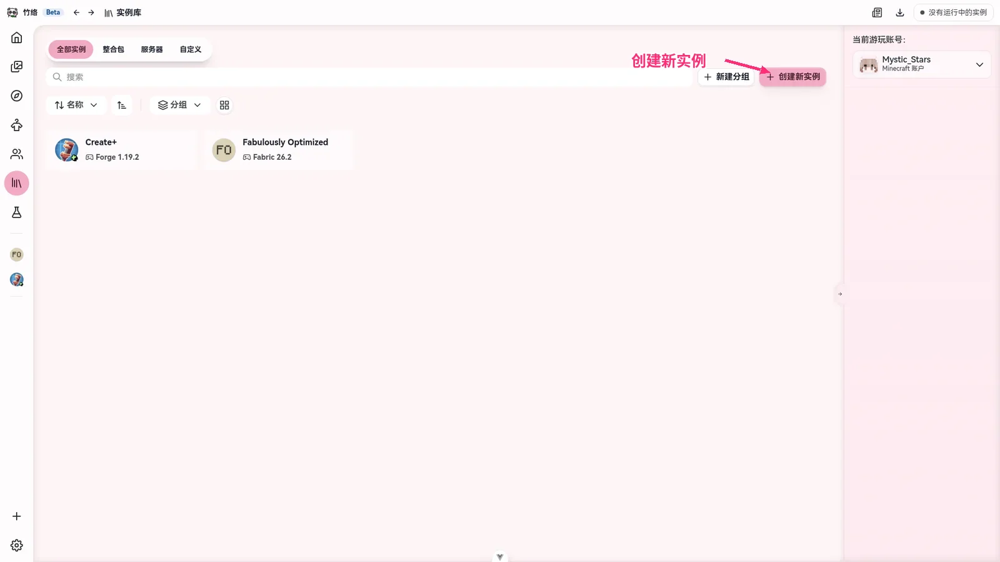

# 创建实例

账户登录好了，现在创建一个属于你的“游戏环境”——在 ChronLink 里叫**实例**。

[**从零上手MC-怎么创建原版实例**](https://www.bilibili.com/video/BV1PN896eETv/)

[**从零上手MC-怎么添加模组mod**](https://www.bilibili.com/video/BV1FWhF61EjC/)

[**从零上手MC-怎么添加光影**](https://www.bilibili.com/video/BV1td4R6qELN/)

## 先搞懂两个名词

### 游戏版本是什么？

Minecraft 更新了很多年，有好多版本：1.20、1.21、26.1、26.2……（近年改成了“年份.序号”命名，26.2 就是 2026 年的第 2 个大版本）

- 不同的**服务器**可能要求不同版本（比如某个服务器是 26.2，你就得用 26.2 进）
- 不同的**模组**也对应不同版本

作为新手，**选最新的正式版就行**（当前最新是 26.2，版本号会不断更新，以启动器里的版本列表为准）。

### 加载器是什么？

加载器可以理解成“装模组的框架”。游戏原版（Vanilla）是不能直接装模组的，要先装一个框架：

| 名称 | 是什么 | 新手建议 |
|---|---|---|
| **原版 (Vanilla)** | 官方纯净版，不装任何模组 | 第一次玩，就选这个！ |
| **Fabric** | 最流行的轻量模组框架 | 想装模组时首选 |
| **Forge** | 老牌模组框架，经典整合包常用 | 想玩老整合包时用 |
| **Quilt / NeoForge** | 其他分支框架 | 遇到特定模组要求时再用 |

> 记不住没关系：**第一次就选“原版”**，先体验游戏本身。等你想装模组了，再回来创建带 Fabric 的实例。

## 开始创建

1. 在 ChronLink 首页，点击 **创建**（Create）按钮
2. 选择**游戏版本**：默认就是最新版，直接下一步
3. 选择**加载器**：新手选“原版”（Vanilla）
4. 起个名字：比如“我的生存世界”，也可以改个好看的图标
5. 点击**创建**

游戏库右上角：创建新实例入口，所有实例都从这里长出来 · 点图可看大图

## 第一次启动

在**游戏库**里找到你刚创建的实例，点击 **启动**：

- **第一次启动会比较慢**：游戏要下载核心文件（几百 MB 到 1GB+），取决于网速，可能几分钟到几十分钟，进度条会告诉你进展
- **Java 不用你自己装**：启动器会自动帮你处理 Java 环境，不用去网上找什么 JDK
- 下载完成后，游戏窗口就会弹出来，进入游戏！

## 启动失败/卡住怎么办？

先别慌，看[常见问题](../more/faq.md))里的“启动问题”部分，多半有答案。

---

*玩过原版了？想加点好玩的 → *[*安装内容*](../content/install-content.md))
