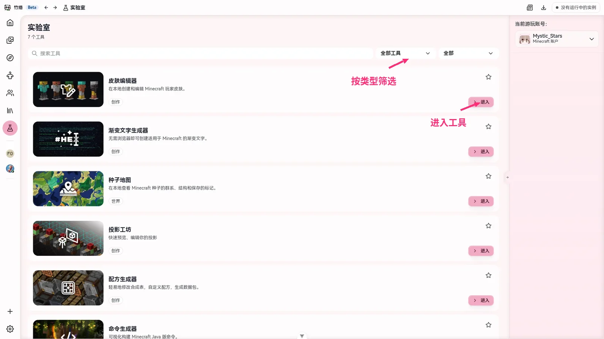

# 实验室

**实验室 (Lab)** 是 ChronLink 内置的实用工具箱。

> 给新手的话：这些是**进阶工具**，先把游戏玩起来，等有需求了再来翻——它们不会跑。

## 工具一览

实验室：每个工具右侧「进入」，右上角还能按类型筛 · 点图可看大图

| 工具 | 用途 | 目标对象 |
|---|---|---|
| 种子地图 | 输入种子，然后查找结构与群系 | 想找好出生点的生存玩家 |
| 投影预览 | 预览投影文件，进行简单编辑 | 建筑，红石玩家 |
| 配方生成器 | 设计自定义合成配方 | 整合包作者 |
| 渐变文字 | 生成彩色文字 | 想在游戏里发彩色文字的玩家 |
| 模组翻译 | 汉化没翻译的模组 | 汉化组、想玩未汉化模组的玩家 |

从启动器侧边栏即可进入实验室。
